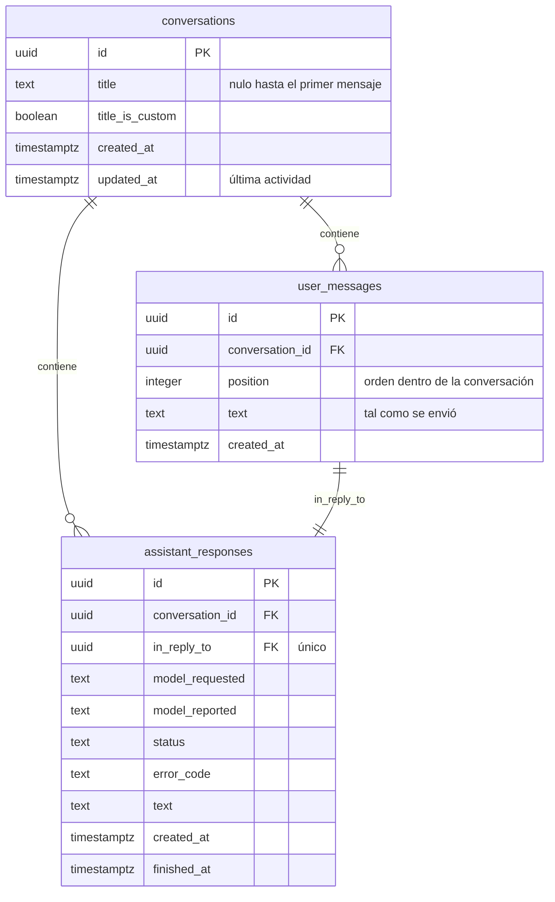

# Esquema de datos: conversaciones (PostgreSQL)

Estado: implementado el 2026-10-30 para [SPEC-002](../specs/002-persistencia-conversaciones.md);
propuesta del agente pendiente de revisión. Refleja el [modelo del chat](../domain/conversations.md). Lo implementa el adaptador
`infrastructure/adapters/outbound/persistence/postgres/`, y las migraciones lo crean (Alembic).

## Diagrama

## Tablas

### `conversations`

| Columna | Tipo | Reglas |
| --- | --- | --- |
| `id` | `uuid` | Clave primaria. En el dominio y en el contrato es la cadena hexadecimal sin guiones. |
| `title` | `text`, nulo | Derivado del primer mensaje o fijado por el usuario. |
| `title_is_custom` | `boolean` | `true` si lo fijó el usuario. Por defecto `false`. |
| `created_at` | `timestamptz` | Asignado por el backend (UTC). |
| `updated_at` | `timestamptz` | Última actividad. Índice descendente para la lista. |

### `user_messages`

| Columna | Tipo | Reglas |
| --- | --- | --- |
| `id` | `uuid` | Clave primaria. |
| `conversation_id` | `uuid` | Referencia a `conversations`, `ON DELETE CASCADE`. |
| `position` | `integer` | 0, 1, 2… dentro de la conversación. Único junto con `conversation_id`. |
| `text` | `text` | Sin recortar (R11) ni límite de longitud (R12). |
| `created_at` | `timestamptz` | |

### `assistant_responses`

| Columna | Tipo | Reglas |
| --- | --- | --- |
| `id` | `uuid` | Clave primaria. |
| `conversation_id` | `uuid` | Referencia a `conversations`, `ON DELETE CASCADE`. |
| `in_reply_to` | `uuid` | Referencia a `user_messages`, `ON DELETE CASCADE`. **Única**: un mensaje tiene exactamente una respuesta (I2). |
| `model_requested` | `text` | |
| `model_reported` | `text`, nulo | |
| `status` | `text` | `CHECK` con los cinco estados de `ResponseStatus`. |
| `error_code` | `text`, nulo | Código de `application/error_codes.py`. |
| `text` | `text` | Texto acumulado; en `streaming`, el del último punto de control. |
| `created_at` | `timestamptz` | |
| `finished_at` | `timestamptz`, nulo | `CHECK`: nulo si y solo si `status = 'streaming'`. |

Índice único parcial `one_streaming_response_per_conversation` sobre `conversation_id`
`WHERE status = 'streaming'`. Hace que I1 (un envío activo por conversación) se cumpla también con
varias peticiones simultáneas: el segundo envío falla al insertar y el adaptador lo traduce a
`SendInProgress`.

## Decisiones de diseño

- **Dos tablas para mensajes**, como en el dominio (R10): los mensajes y las respuestas tienen campos
  distintos, y la relación 1:1 queda explícita con `in_reply_to` único. El orden de la conversación
  es el de `user_messages.position`, con cada respuesta detrás de su mensaje.
- **No se guarda `active_response_id`**: se deduce de la respuesta en `streaming`.
- **No se guardan el mensaje de error ni `retryable`**: el mensaje sale de la tabla por código, como en
  el stream.
- **SQLAlchemy Core sin ORM**: el dominio no se mapea con clases de SQLAlchemy y el adaptador
  traduce filas a entidades. Así el dominio sigue siendo independiente de la persistencia.
- **Escrituras por partes**: aceptar un envío inserta el mensaje y la respuesta y actualiza la
  conversación en una transacción; los puntos de control y el final actualizan solo la fila de la
  respuesta.
