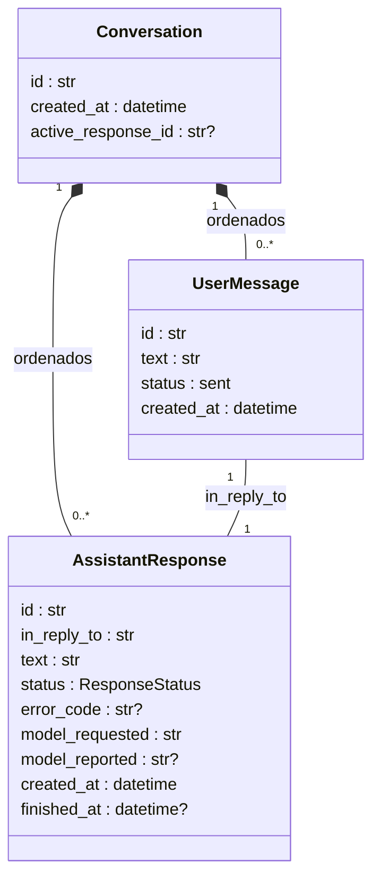
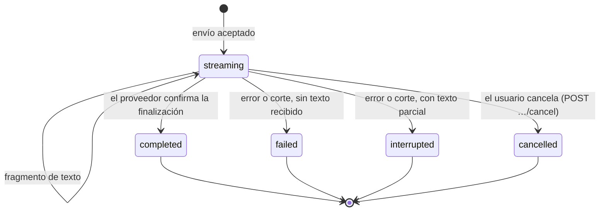

# Modelo del chat (SPEC-001)

Estado: **acordado** el 2026-10-29. El usuario revisó la propuesta del agente (decisiones R1–R12 y
bloques B y C, al final) y el código, el contrato [chat-v1](../api/chat-v1.md) y las pruebas están
alineados con este documento. Implementación en `src/ai_assistant/conversations/`.

Fuentes: [SPEC-001](../specs/001-chat-texto.md), [arquitectura](../architecture.md),
[visión](../product/vision.md).

Decisiones documentadas antes de este modelo, que lo enmarcan:

- La conversación es temporal y el historial solo existe durante la sesión; la UI comunica que no se persiste.
- Hay un único envío activo por conversación y un doble clic no inicia dos solicitudes.
- Solo el evento de finalización confirma una respuesta completa.
- Un error conserva el texto del usuario y muestra una explicación sin secretos técnicos.
- Si queda texto parcial, se marca como interrumpido o cancelado.
- No hay reintento automático de una generación parcialmente recibida.
- Cancelar detiene el consumo local y cierra la conexión con el proveedor; no se promete eliminar el consumo ya generado.
- Desktop y mobile hablan solo con la API del backend; el transporte es SSE.
- El catálogo de modelos se distingue de los modelos con acceso comprobado (`response.completed`).

## 1. Entidades, relaciones y campos

Las dos clases se guardan en una sola lista ordenada (`Conversation.messages`), alternando mensaje y
respuesta. Todas las fechas son UTC, las asigna el backend con un reloj inyectable y el contrato las
expone en ISO 8601 con `Z`.

### Conversation (agregado raíz)

| Campo | Tipo | Significado |
| --- | --- | --- |
| `id` | cadena opaca (hoy `uuid4().hex`) | Identificador. Los clientes no deben interpretarlo. |
| `created_at` | fecha y hora UTC | Momento de creación. |
| `messages` | lista ordenada | Mensajes del usuario y respuestas, en orden de creación. |
| `active_response_id` | cadena o nulo | Respuesta en curso. Dato interno; no se expone. |

### UserMessage

| Campo | Tipo | Significado |
| --- | --- | --- |
| `id` | cadena opaca | En el contrato, `message_id`. |
| `text` | cadena | Tal como se envió, **sin recortar espacios** (R11). Sin límite de longitud en v1 (R12). |
| `status` | `sent` | Único estado. Los mensajes rechazados no llegan a existir. |
| `created_at` | fecha y hora UTC | Momento de aceptación. |

### AssistantResponse

| Campo | Tipo | Significado |
| --- | --- | --- |
| `id` | cadena opaca | En el contrato, `response_id`. |
| `in_reply_to` | id de `UserMessage` | Mensaje al que responde (R10). |
| `text` | cadena | Texto acumulado de los fragmentos recibidos. Puede ser parcial. |
| `status` | `ResponseStatus` | Sección 2. |
| `error_code` | cadena o nulo | Código del puerto (`usage_limit`, `interrupted`, …) si terminó en error. |
| `model_requested` | slug | Modelo pedido al proveedor (`gpt-6-luna`). |
| `model_reported` | cadena o nulo | Modelo que el proveedor declara haber usado (sección 5). |
| `created_at` | fecha y hora UTC | Momento de aceptación del turno (igual al del mensaje). |
| `finished_at` | fecha y hora UTC o nulo | Momento en que alcanzó un estado final. |

### Fuera de la conversación

- **Opción de modelo** (para el selector): `id` (slug), `display_name` y `access` (`verified` o
  `unverified`). Combina el catálogo del proveedor con el registro local de modelos comprobados, que
  depende del registro OAuth (`client_id`) y vive en el adaptador, no en el dominio.
- **Turn** (`application/chat.py`) maneja un envío en curso: consume el proveedor en una tarea asyncio
  propia y entrega los eventos. No es una entidad del dominio.

## 2. Estados y transiciones

### Mensaje del usuario

`sent` es su único estado y es definitivo. Los mensajes vacíos, los rechazados con `409` y los
enviados a una conversación inexistente no crean ningún mensaje. El resultado del turno se refleja
solo en la respuesta.

### Respuesta del asistente

| Estado | Cuándo |
| --- | --- |
| `streaming` | Desde la aceptación hasta el fin. Acumula fragmentos. |
| `completed` | **Solo** si el proveedor confirma la finalización (`response.completed`). |
| `failed` | Error del proveedor o del backend, `incomplete` o corte de cualquier conexión, **sin** texto recibido. |
| `interrupted` | Los mismos casos **con** texto parcial. |
| `cancelled` | El usuario pidió cancelar con el endpoint de cancelación (R5). Conserva el texto recibido hasta ese momento. |

Un corte de la conexión del cliente **sin** pedir cancelar no es una cancelación: se aplica la regla
de `failed`/`interrupted` con el código `interrupted`.

Transiciones no permitidas: salir de un estado final o añadirle texto. El dominio lanza
`ResponseNotActive`; los fragmentos que el proveedor envíe después de cancelar se descartan sin error.

## 3. Invariantes

| # | Invariante | Dónde se garantiza |
| --- | --- | --- |
| I1 | Hay como mucho una respuesta en `streaming` por conversación, y `active_response_id` apunta a ella. | Dominio (`begin_turn`). Comprobar y reservar es atómico porque el servicio corre en un único bucle asyncio sin `await` en medio. |
| I2 | Cada mensaje aceptado tiene exactamente una respuesta, creada en la misma operación. Un reintento es un mensaje nuevo (R4). | Dominio |
| I3 | Una respuesta solo pasa a `completed` por confirmación del proveedor, nunca por llegar al final del flujo. | Caso de uso |
| I4 | Los estados finales son inmutables, tanto el estado como el texto. | Dominio y caso de uso |
| I5 | Mientras está en `streaming`, el texto solo crece. | Dominio |
| I6 | Un texto vacío o solo con espacios nunca se acepta ni llega al proveedor. | Dominio |
| I7 | El proveedor solo se llama después de aceptar el envío, una vez por turno. Sin reintentos automáticos. | Caso de uso |
| I8 | El modelo es obligatorio y no vacío. No se valida contra el catálogo: si no existe, el error llega del proveedor (`model_unavailable`). | Caso de uso |
| I9 | Un envío aceptado se consume (`Turn.events()`), se cancela o se abandona (`Turn.close()`); si no, la conversación queda bloqueada hasta que se cancele. | Contrato interno de `Turn`; la capa HTTP debe cumplirlo |

## 4. Contenido parcial, cancelaciones y errores

| Final | Qué conserva la sesión | Qué ve el cliente | Qué se reenvía al proveedor después |
| --- | --- | --- | --- |
| `completed` | Texto completo, `model_reported`, `finished_at` | Fragmentos y `response.completed` | El mensaje y la respuesta |
| `failed` | Texto vacío, `error_code` | `response.failed` con `status: failed` | Nada de este turno |
| `interrupted` | Texto parcial, `error_code` | Fragmentos y `response.failed` con `status: interrupted` | Nada de este turno |
| `cancelled` | Texto recibido hasta cancelar | `response.cancelled` si el stream sigue abierto | Nada de este turno |
| Corte del cliente sin cancelar | `interrupted` o `failed`, código `interrupted` | Nada (no está conectado); marca el parcial como interrumpido | Nada de este turno |

Reglas:

- Al proveedor solo se reenvían los intercambios `completed` y el mensaje actual (R3).
- El mensaje que ve el usuario sale de una tabla fija por código y nunca incluye detalles técnicos.
  `retryable` se calcula en cada fallo y no se guarda.
- Un reintento manual crea un turno nuevo con el mismo texto; el intento anterior se queda con su
  estado (R4).
- Una excepción inesperada durante el turno es `internal_error` (no reintentable). Se registra en log
  solo el tipo de excepción y las líneas de código, sin el mensaje de la excepción, tokens ni texto
  del usuario (R8). Los fallos del proveedor, la red, el proxy o la sesión los traduce el adaptador
  a sus códigos propios.

## 5. Fechas y modelo que generó la respuesta

- `created_at` se asigna al aceptar; `finished_at`, al llegar a un estado final (R1).
- `model_requested` es el slug enviado (R2).
- `model_reported` es el `response.model` que informa el proveedor. **Comprobado el 2026-10-29**
  ([evidencia](../evidence/001-viabilidad-proveedor.md#2026-10-29--modelo-informado-por-el-proveedor-r2-del-modelo-del-chat)):
  llega en `response.created`, `response.in_progress` y `response.completed`, y en la prueba coincidió
  con el slug pedido. El adaptador conserva el último valor recibido y lo adjunta al final, también
  si la respuesta falla o se corta. En una cancelación queda nulo. No se ha comprobado si
  `response.failed` y `response.incomplete` lo incluyen.
- Al completarse una respuesta del chat con el proveedor real, el adaptador marca `model_requested`
  como modelo con acceso comprobado (R9), igual que la CLI de la prueba.

## 6. Temporal frente a persistente

Temporal:

- Todo lo anterior vive en la memoria del proceso del backend y se pierde al reiniciarlo.
- No hay endpoints para leer el historial.
- Desktop guarda su propia copia de vista durante la sesión, construida a partir de los eventos.

Ya persiste, porque es estado del adaptador y no del chat: credenciales cifradas, `host-id` y el
registro de modelos comprobados.

Pendiente para una especificación de persistencia (etapa 2 de la visión), sin diseñar todavía:

- Identidad del propietario y del dispositivo de origen.
- Qué estados se guardan, incluidos los parciales y cancelados; retención y borrado.
- Lectura del historial desde el servidor, orden y paginación.
- Idempotencia de envíos repetidos por el cliente (p. ej. un `client_message_id`).
- Trasladar la garantía de I1 del bucle asyncio al almacenamiento; el repositorio pasaría a ser asíncrono.

## 7. Correspondencia con el contrato chat-v1

| Modelo | Contrato chat-v1 |
| --- | --- |
| `Conversation.id`, `created_at` | `POST /v1/conversations` → `conversation_id`, `created_at`, `persisted: false` |
| `UserMessage.id` | `message.accepted.message_id` |
| `AssistantResponse.id` | `response_id` en todos los eventos |
| `in_reply_to` | `message.accepted` une `message_id` con `response_id` |
| `AssistantResponse.created_at`, `model_requested` | `message.accepted.created_at`, `model_requested` |
| `text` | Suma de los `response.delta.text` |
| `completed` | `response.completed` (`finished_at`, `model_reported`) |
| `failed` / `interrupted` | `response.failed` (`status`, `finished_at`, `model_reported`, `error`) |
| `cancelled` | `POST …/cancel` → `204`, y `response.cancelled` (`finished_at`) en el stream |
| `error_code` | `response.failed.error.code` |
| Mensaje de error y `retryable` | `response.failed.error.message` y `retryable`; no se guardan |
| Opción de modelo | `GET /v1/models` (`id`, `display_name`, `access`) |

## 8. Cancelación

Comportamiento implementado (núcleo asíncrono, R6 y R7):

1. `ChatService.cancel` marca la respuesta `cancelled` y libera la conversación **en el acto**, sin
   esperar al proveedor. Un envío nuevo se acepta inmediatamente.
2. Después cancela la tarea que consume el proveedor. Eso interrumpe la espera de red y cierra la
   respuesta HTTP con el proveedor. `cancel` espera ese cierre como mucho 5 s.
3. Si el stream SSE del cliente sigue abierto, recibe `response.cancelled` como evento final.
4. Lo que el proveedor envíe después se descarta: el texto queda como estaba al cancelar.
5. Si se cancela antes de empezar a consumir el stream, no se llama al proveedor.

Pruebas que lo cubren: cancelar con el proveedor simulado bloqueado (`test_chat_use_case.py`) y con
el adaptador real sobre un stream httpx detenido (`test_chatgpt_plan_provider.py`).

Con la capa HTTP también está comprobado sobre un servidor uvicorn real (`test_http_api.py`):
cancelar con el proveedor detenido responde `204` en menos de 1 s y el stream recibe
`response.cancelled`; cerrar la conexión sin cancelar deja la respuesta `interrupted` y cierra la
conexión con el proveedor. uvicorn declara ASGI 2.3, así que Starlette detecta la desconexión en
cuanto llega `http.disconnect`, sin esperar al siguiente envío.

El comportamiento anterior (núcleo síncrono), medido el 2026-10-29, solo podía cancelar entre dos
eventos: mientras se esperaba al proveedor, la conversación seguía bloqueada hasta el siguiente
fragmento o hasta el timeout de lectura de 120 s.

## Registro de decisiones (2026-10-29)

Propuestas del agente y decisión del usuario:

| # | Decisión |
| --- | --- |
| R1 | `created_at` en conversación, mensaje y respuesta; `finished_at` en la respuesta; UTC ISO 8601 asignado por el backend. |
| R2 | Guardar `model_requested` y `model_reported` y exponerlos en los eventos. |
| R3 | Al proveedor solo se reenvían los intercambios `completed` y el mensaje actual. |
| R4 | Un reintento manual es un turno nuevo con el mismo texto. Sin reintentos automáticos. |
| R5 | Endpoint de cancelación explícito en v1. Cancelar → `cancelled`; corte de conexión sin cancelar → `interrupted`/`failed`. |
| R6 | Cancelar libera la conversación de inmediato y descarta los fragmentos tardíos. |
| R7 | Puerto y caso de uso asíncronos (`AsyncIterator`, `httpx.AsyncClient`). |
| R8 | Código `internal_error` con registro en log sin tokens ni texto del usuario. |
| R9 | El chat también actualiza el registro de modelos comprobados. |
| R10 | Dos clases, `UserMessage` y `AssistantResponse`, con `in_reply_to` explícito. |
| R11 | El texto del usuario se guarda y se envía sin recortar espacios. |
| R12 | Sin límite de longitud en v1. |
| B1 | `incomplete` es reintentable; `usage_limit` y `provider_error` no. |
| B2 | En v1 el modelo no se valida contra el catálogo antes de llamar al proveedor. |
| B3 | Códigos HTTP de los errores de `GET /v1/models` (ver el contrato). |
| C | Reglas de estados e invariantes de las secciones 2 y 3. `incomplete` sin texto termina en `failed`. |

Detalles que fijó el agente al implementar, dentro de lo acordado: el evento `response.cancelled` en el
stream, los códigos `response_not_found` y `response_not_active` del endpoint de cancelación,
`internal_error` no reintentable y el límite de 5 s para esperar el cierre con el proveedor.
